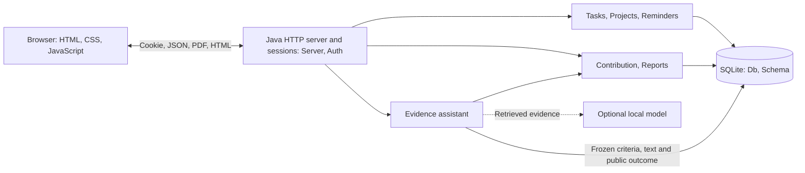

# System design

The browser displays the actions available to each member. The Java HTTP service enforces the rules and permissions in the [SRS](SRS.md).

## Components and data boundaries

The server serves [dist/](../dist/) on loopback and authorizes requests against sessions and project membership. SQLite uses WAL, foreign keys and short-lived connections. [Db.write](../server/src/af/Db.java) wraps a write in a transaction and retries the entire operation after rolling back a busy database. Read the response set and make the scoring decision in the transaction that closes the round. The browser polls chat every four seconds, cancels requests when hidden or switching projects, and verifies the active project before rendering a response.

| ID | Implementation | Routes and persistence |
| --- | --- | --- |
| D-01 Accounts and teams | [Auth](../server/src/af/Auth.java), [Projects](../server/src/af/Projects.java) | Authentication, project creation, joining and leaving use users, sessions, projects and project_members. |
| D-02 Tasks and budgets | [Tasks.create, reassign, editAuthors](../server/src/af/Tasks.java), [Projects.revisePlan](../server/src/af/Projects.java) | Project tasks and plan endpoints, task reassign and authors endpoints. Store tasks, task_authors, plan_changes, reassignments and events. Check the budget and insert the task in the same transaction. |
| D-03 Versioned review | [Tasks.submit, confirm, vote, withdraw](../server/src/af/Tasks.java) | submissions stores the text, points, criteria and PDF. submission_authors and submission_eligible freeze the participants. Ballots determine final acceptance and each member’s own available actions. |
| D-04 Board, reminders and communication | [Reminders](../server/src/af/Reminders.java), [Projects](../server/src/af/Projects.java), [browser](../dist/assets/app.js) | Board, messages, support, note and extension endpoints. A unique task/checkpoint pair identifies each reminder. Authorize private events against the original recipient. task_support is separate from version status. |
| D-05 Disputes | [Reports.create, recoverPlan](../server/src/af/Reports.java) | Create the dispute and report_plans snapshot together. Responses and independent reviews enter report_statements. Migrations use original plans, handoffs and event order to reconstruct filing-time roles; missing data limits review. |
| D-06 Evidence questions | [Evidence.resolveTarget, criteriaAnswer](../server/src/af/Evidence.java) | The project AI endpoint receives the question and selected task/version. Return missing or ambiguous matches before assessing criteria. Read saved version text and public outcomes. An optional local model explains the evidence. |
| D-07 Points and export | [Contribution.calculate](../server/src/af/Contribution.java), [Reports.exportHtml](../server/src/af/Reports.java) | Project report and export endpoints join task_scores to frozen submission_authors. Sum before rounding for display. Include the raw JSON appendix and downloadable copies of selected versions’ PDFs. |

## Review rounds

| Current state | Request and conditions | Effect |
| --- | --- | --- |
| No open round | Assignee or author submits valid work on an unscored task; the authors are current members. | Create a pending version and freeze its points, authors and eligible participants. Record the submitter’s confirmation if they are an author. |
| Pending | An eligible person responds but at least one response is missing. | Remain pending. The public state does not reveal dissent. |
| Pending | The final required response arrives. | Dissent rejects the version. Unanimity accepts it and attempts to insert the unique score in the same transaction. |
| Pending | A current author of this version gives a nonblank withdrawal reason. | Mark withdrawn, record reason and date, retain the artifact and stop collection. |
| Pending | Someone saves a draft, submits again or leaves. | Keep the round open. The tab stores its draft. Resubmission returns a conflict and explains how to withdraw. |
| Accepted, rejected, withdrawn or historically superseded | Someone responds to the old version. | Reject the action. An unscored task may start a new version with fresh eligibility. |

Author confirmations are public signatures. Ballots generate no individual public records or notifications. Each session receives only its own action eligibility. The sole non-author in a two-person group sees an inference warning. All-author groups require signatures and separate anonymous ballots.

Both withdrawal and finalization update a version only while its status is pending. At most one concurrent transaction can close it. Unique constraints on task_scores.task_id and submission_id guard against duplicate credit. A retried transaction rechecks the committed state.

## Worked example: questionnaire design and pilot

The task endpoints below use the prefix `/api/projects/{p}/tasks/{t}`. This case exercises FR-03 through FR-09 and NFR-01/02.

| Stage | What members see | Implementation |
| --- | --- | --- |
| Agreement | Alice and Ben agree on 60/40 of a 30-point task. Cara and Dan are teammates. | Insert tasks and task_authors together. |
| v1 submission | Alice submits and confirms her own work. Ben can confirm. Cara and Dan can vote. | POST /submissions freezes the version and eligibility atomically. GET /submissions/{s}/attachment checks membership. |
| Early dissent | Ben confirms, Cara disagrees and Dan has yet to vote. The board shows Pending review. | The confirm and vote endpoints call Tasks.finalizeIfComplete. |
| v1 closes | Dan responds. The version is rejected and earns zero. Its text and authors remain accessible. | Store terminal status and time, then append a public closure event. |
| v2 accepted | After revision, everyone responds again. Unanimity scores the task once for 30 points. | Create a new version ID. Commit the final response, terminal state and task_scores row together. |
| Export | A member previews the project report and checks that v2 awards Alice 18 and Ben 12. | GET /api/projects/{p}/report/export returns the frozen shares and points in the appendix. |

[Requirements and verification evidence](REQUIREMENTS_COVERAGE.md)
