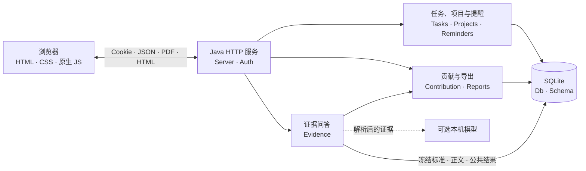

# 设计说明

适用于 [SRS](SRS.md) 中的首版网页。实现以 Java HTTP 服务为业务和权限边界，静态界面展示成员可用操作。

## 组件与数据边界

浏览器从 [dist/](../dist/) 加载。服务监听回环地址，通过会话和项目成员关系授权。SQLite 使用 WAL、外键和短连接。写操作由 [Db.write](../server/src/af/Db.java) 包在一个事务中，遇到 SQLite 忙状态会回滚并重试整个操作。投票集合和计分读取在该事务内执行。消息每 4 秒轮询一次，标签页隐藏或切换项目时取消请求，并在渲染前再核对请求归属。

| 设计位置 | 类或模块 | 路由和持久化 |
| --- | --- | --- |
| D-01 账号与组队 | [Auth](../server/src/af/Auth.java)、[Projects](../server/src/af/Projects.java) | `/api/auth/{register,login,logout}`、`/api/projects`、`/join` 与项目 `/leave`。使用 `users`、`sessions`、`projects`、`project_members`。 |
| D-02 任务与预算 | [Tasks.create / reassign / editAuthors](../server/src/af/Tasks.java)、[Projects.revisePlan](../server/src/af/Projects.java) | 项目 `/tasks`、`/plan`，任务 `/reassign`、`/authors`。`tasks`、`task_authors`、`plan_changes`、`reassignments` 和事件。预算读取与任务插入同事务。 |
| D-03 版本与验收 | [Tasks.submit / confirm / vote / withdraw](../server/src/af/Tasks.java) | 下文所列版本路由。`submissions` 保存正文、分值、标准与 PDF；`submission_authors` 和 `submission_eligible` 冻结人员。只有验收事务和当前用户自身的操作资格读取 `votes`。 |
| D-04 公告、提醒和沟通 | [Reminders](../server/src/af/Reminders.java)、[Projects](../server/src/af/Projects.java)、[app.js](../dist/assets/app.js) | 项目 `/board`、`/messages` 与任务 `/support`、`/note`、`/extension`。`reminders(task_id,checkpoint_at)` 唯一键，每条私下事件按提醒的原收件人授权。`task_support` 与版次状态独立。 |
| D-05 举报 | [Reports.create / recoverPlan](../server/src/af/Reports.java) | 项目 `/reports` 及案件的 `/respond`、`/review`。创建同事务保存 `reports` 与 `report_plans`，陈述写 `report_statements`。迁移从 `original_plan`、交接和事件顺序还原；资料缺失时限制复核。 |
| D-06 证据问答 | [Evidence.resolveTarget / criteriaAnswer](../server/src/af/Evidence.java) | 项目 `/ai`，接收问题及选中的任务、版本。匹配不到或歧义时先返回；比较标准时读匹配版本正文与公共结果。可选本机模型解释这些证据，贡献由程序计算。 |
| D-07 分值与导出 | [Contribution.calculate](../server/src/af/Contribution.java)、[Reports.exportHtml](../server/src/af/Reports.java) | 项目 `/report`、`/report/export`。从 `task_scores` 到冻结 `submission_authors`，汇总未舍入的分值后显示舍入值。HTML 内附复算 JSON，选中版本的 PDF 可随报告下载。 |

## 验收轮次

| 当前 | 请求及条件 | 下一状态与写入 |
| --- | --- | --- |
| 无开放轮次 | 当前负责人或作者提交有效成果，任务尚未入账，所有新版作者仍为组员 | 新版「待确认」。写版本、分值快照、署名、资格；提交者若署名则记本人确认。 |
| 待确认 | 合资格作者确认或匿名选民投票，仍有必需回应缺席 | 保持待确认。公共状态在收齐前相同。 |
| 待确认 | 最后一项必需回应收齐 | 有反对为「未通过」；全票同意为「通过」，在同一事务尝试写唯一计分行。 |
| 待确认 | 仍在项目中的本版作者用非空原因撤回 | 「已撤回」；写原因与日期，保留成果，停止收票。 |
| 待确认 | 保存草稿、重提或成员离组 | 保持原轮次。草稿在页面会话；重提接口返回冲突及撤回提示。 |
| 通过／未通过／已撤回／历史被取代 | 对同一版本再次回应 | 返回冲突，旧版保持终态。未入账任务可提交新版本，重新确定资格。 |

作者确认公开显示，匿名票不连到公共记录或通知。当前会话可见自己的操作资格。两人组只有一位非作者时显示推断风险提示。全员署名时，同一成员有确认与匿名投票两个操作。

撤回与终结都以 `WHERE status='pending'` 更新；两次并发事务中只有一个能结束轮次。计分以 `task_scores.task_id UNIQUE` 和 `submission_id UNIQUE` 约束。重试后仍依据已提交状态校验。

## 贯穿案例 · 问卷设计与预测试

以下路径以 `/api/projects/{p}/tasks/{t}` 为前缀，涉及 FR-03 至 FR-09 和 NFR-01、NFR-02。

| 时点 | 成员操作与可见结果 | 后端、表与事务 |
| --- | --- | --- |
| 约定 | Alice 和 Ben 分别署名 60%／40%，任务 30 分，Cara 和 Dan 同属项目。 | 创建任务时在同一事务写 `tasks`、`task_authors`。 |
| v1 提交 | Alice 提交问卷正文，系统记录她的确认；Ben 可确认，Cara 和 Dan 分别可匿名投票。 | `POST /submissions`，`Tasks.submit` 原子冻结 `submissions`、`submission_authors`、`submission_eligible`。可按版本授权 `GET /submissions/{s}/attachment`。 |
| 先有反对 | Ben 确认，Cara 投反对，Dan 还未投；公告栏仍显示「待确认」。 | `POST /submissions/{s}/confirm`、`/vote`。`Tasks.finalizeIfComplete` 检查集合。 |
| v1 收齐 | Dan 提交后整轮「未通过」，任务得 0 分，旧正文和作者保留。 | 更新 `submissions.status` 和终结日期，写公共终结事件。 |
| v2 通过 | 作者修订并再次提交；重新确认和投票。本轮全票同意，任务入账 30 分。 | 新 `submissions.id`，资格重新冻结；最后回应、终态与 `task_scores` 同一事务。 |
| 导出 | 成员在同一个项目预览，下载报告后从 v2 复算 Alice 18 分、Ben 12 分。 | `GET /api/projects/{p}/report/export`，`Reports` 取分值与 v2 冻结份额，生成可复算附录。 |

[需求追踪和实测](REQUIREMENTS_COVERAGE.md)
